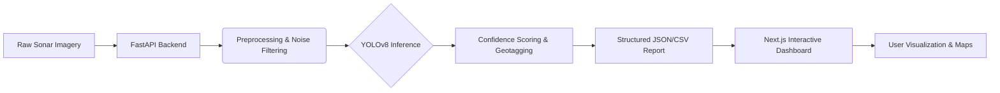

# 🌊 SIH26057 — AI-Powered Marine Debris & Anomaly Detection System

> **End-to-End Automated Computer Vision Pipeline for Side-Scan Sonar Imagery**  
> High-performance inference engine built on YOLOv8 for detecting anthropogenic debris (ghost nets, shipwrecks) in the vast ocean.

---

## 🌟 Background & Problem Statement

The accumulation of anthropogenic (man-made) debris in marine ecosystems poses a critical threat to global biodiversity. Among the most destructive types of pollution are **'ghost nets'**—abandoned, lost, or discarded fishing gear. These nets continuously trap and kill marine life, destroy coral reefs, and damage commercial vessel propellers.

Because the ocean is vast and dark, marine conservationists and underwater technologists rely on **Side Scan Sonar (SSS)** instruments. These sensors are towed behind ships or mounted on Autonomous Underwater Vehicles (AUVs) to create detailed acoustic maps of the seafloor.

However, manual inspection of thousands of kilometers of sonar logs is incredibly slow, tedious, and prone to human error. Debris can easily blend into natural geological features like rock formations, sand ripples, and marine ridges. Automating this process via computer vision is essential for efficient ocean cleanup operations.

---

## 🛠️ The Solution

We have developed a functional, modular software prototype containing the following core components to solve this challenge:

| Component | Description |
| :--- | :--- |
| **Object Detection Model** | An AI/ML architecture (YOLOv8) trained to detect and draw bounding boxes around man-made objects (shipwrecks, pipes, cylinders, and entangled debris nets). |
| **Noise Filtering Module** | An algorithmic pipeline that minimizes false positives caused by natural acoustic shadows or rock clusters, outputting a clear confidence score (0% to 100%). |
| **Geotagging Engine** | A data-parsing script that reads sonar metadata (coordinate files or ping headers) to output a structured report detailing exact location and bounding dimensions. |
| **UI Dashboard** | A visual interface where users can upload raw sonar image logs, view AI detections overlaid on the map in real-time, and download generated anomaly reports. |

---

## 🏗️ System Architecture

Our solution is divided into a robust backend processing engine and an interactive frontend dashboard.



```text
.
├── backend/                # FastAPI backend server and ML pipeline
│   ├── src/                # Core Python source code for inference & pipelines
│   ├── models/             # Pre-trained YOLOv8 models (best.pt)
│   └── requirements.txt    # Python dependencies
├── frontend/               # Next.js frontend web application
│   ├── app/                # Next.js App Router & Pages
│   ├── components/         # Reusable React components (Maps, Uploaders)
│   └── package.json        # Node.js dependencies
└── README.md               # Main project documentation
```

---

## 🚀 Setup Instructions

Whether you are running the project on your local machine or deploying it, follow these steps.

### 1. Backend Setup (FastAPI & ML)

Open **Terminal 1** and navigate to the `backend` directory:

```bash
cd backend

# Create and activate a virtual environment
python -m venv .venv
# On Windows: .venv\Scripts\activate
# On Linux/macOS: source .venv/bin/activate

# Install dependencies
pip install -r requirements.txt

# Start the development server
uvicorn src.main:app --reload --host 0.0.0.0 --port 8000
```

> **Startup Verification**: The API will be available at `http://localhost:8000`. You can test the endpoints using the interactive documentation at `http://localhost:8000/docs`.

### 2. Frontend Setup (Next.js Dashboard)

Open **Terminal 2** and navigate to the `frontend` directory:

```bash
cd frontend

# Install dependencies (pnpm recommended)
npm install -g pnpm
pnpm install

# Start the development server
pnpm dev
```

> **UI Access**: The web dashboard will be available at `http://localhost:3000`.

---

## 🌐 Deployment

This project is optimized for a decoupled deployment architecture, using **Cloudflare Pages** for the frontend and **Railway** for the backend.

### 1. Frontend (Cloudflare Pages)
Cloudflare provides a blazing-fast global edge network perfect for this Next.js dashboard.
1. Push this repository to your GitHub.
2. Log in to [Cloudflare Dashboard](https://dash.cloudflare.com/) and go to **Workers & Pages > Pages**.
3. Click **Connect to Git** and select this repository.
4. Set the **Framework preset** to `Next.js`.
5. Set the **Root directory** to `frontend` (Important!).
6. Under Environment Variables, add `NEXT_PUBLIC_API_URL` and set it to your Railway backend URL (e.g., `https://your-backend.up.railway.app`).
7. Click **Save and Deploy**.

### 2. Backend (Railway)
Railway easily handles the heavy Python ML dependencies and the FastAPI server.
1. Log in to [Railway](https://railway.app/) and click **New Project > Deploy from GitHub repo**.
2. Select this repository.
3. Once deployed, go to the project settings, and set the **Root Directory** to `/backend`.
4. Under the **Variables** tab, ensure you add necessary environment variables (if any, like `CORS_ORIGINS` to allow your Cloudflare frontend URL).
5. Railway will automatically detect the `requirements.txt` and FastAPI setup. It will generate a public `https://` domain for you to use in your frontend.
